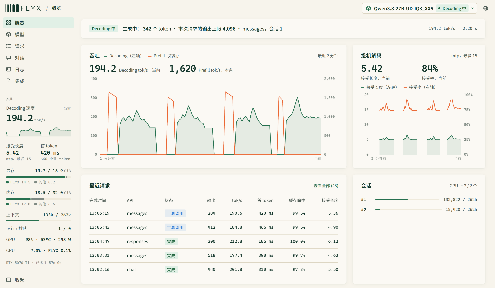

<p align="center">
  <picture>
    <source media="(prefers-color-scheme: dark)" srcset="docs/brand/flyx-readme-banner-dark.svg">
    
  </picture>
</p>

<p align="center">
  <a href="LICENSE"></a>
  
  <a href="https://discord.gg/ZtUPXBxYhN"></a>
  <a href="https://enwove.ai/flyx/wechatqr"></a>
</p>

<p align="center">
  <a href="README.md">English</a> · <b>中文</b> &nbsp;|&nbsp;
  <a href="#快速开始">快速开始</a> ·
  <a href="#实测性能">实测性能</a> ·
  <a href="docs/models.md">模型支持</a> ·
  <a href="docs/server.md">CLI 与 API</a> ·
  <a href="llms.txt">llms.txt</a>
</p>

**FLYX** 是一款约 50 MB 的零依赖本地大模型引擎：原生长上下文、逐卡自动调优，免安装、免配置。直接加载现成 GGUF，无需转换格式，通过 OpenAI 与 Anthropic 双协议 API 开箱接入浏览器、脚本与主流 Coding Agent。

<p align="center">
  
  <br><sub>内置图形控制台：模型管理、对话、实时吞吐与显存/内存监控、Coding Agent 一键接入。</sub>
</p>

## 核心特性

- **原生长上下文，不降智** — 默认解锁模型完整训练上下文，单张消费级显卡即可跑通。K/V 缓存超出显存时无缝延展至系统内存，不截断、不滑窗：24 GB RTX 4090 在 256K 仍达 **123 tok/s**，RTX 5090（`NVFP4`）在 256K 达 **165 tok/s**，且 **32K–256K 大海捞针 100% 精准召回**（[实测详情](docs/benchmarks.md#1-qwen38-27b-long-context-coding-benchmark)）。
- **逐卡调优，告别反复试超参** — 内置 11 款主流 NVIDIA 显卡的实测 kernel 调优表，启动时根据可用显存与内存自动配置上下文长度、KV 精度与显存/内存配比，不再手动折腾卸载层数、batch 和缓存类型。
- **免安装、免依赖、约 50 MB** — CUDA 与 C++ 运行库全部静态内置，只需 NVIDIA 驱动（≥ 580），不装 CUDA Toolkit、Python 或 Docker。Windows 是单个约 50 MB 的 `.exe`（双击即运行），Linux 为约 45 MB 压缩包。
- **自带图形面板 & 终端监控** — 启动自动打开多语言 Web 控制台（中/英/日/韩/德/法/西 7 种语言），带实时状态引导与完整本地化 API 文档；可直接检索加载 Hugging Face 或本地模型、发起对话，并实时查看速度、显存/内存分布、会话上下文、请求详情与日志（[面板说明](docs/monitor.md)）。
- **一键接入多个 Coding Agent** — 同时兼容 OpenAI（Chat Completions / Responses）与 Anthropic Messages 协议，支持工具调用与多轮前缀缓存；在面板 **Integration** 页即可**一键选目录拉起 Claude Code 或 Codex CLI**（Windows），或复制命令接入 **DeepSeek Harness、OpenCode、Pi**。
- **精度可验证，绝不暗中掉点** — 全算子对标 `float64` 参考实现回归测试；默认 FP8 KV 在 27B 上相对 16-bit 的 KL 仅 **0.0009–0.0016**；任何加速路径与基准解码**逐 token 完全一致**（[精度与数值契约](docs/design/numerics.md)）。

## 更新动态

- **`2026-11`** — **FLYX 首次开源发布**：提供约 50 MB 零依赖 Windows 单文件 `.exe` 与 Linux 压缩包，开箱支持 GGUF / NVFP4 原生全上下文推理与显存/内存自动延展、内置精确投机解码（MTP / DFlash2）、7 语言 Web 控制台，以及一键接入 Claude Code / Codex CLI。

## 实测性能

在 **Qwen3.8-27B GGUF** 上使用内置 **MTP** 投机解码（`--drafter mtp --ctx max --chat --no-think -n 512 --ignore-eos`），在 **1K / 128K / 256K** 上下文长度下运行 512 token 代码生成贪心实测（RTX 5090 测 Blackwell 原生 `NVFP4`，24 GB 显卡测 `UD-Q4_K_XL`，16 GB 显卡测 `UD-IQ3_XXS`；完整预填充耗时、262K 自动显存/内存分布、`flyx bench` 投机对比与复现命令见 [docs/benchmarks.md](docs/benchmarks.md)）：

| 显卡 | 量化版本 | 1K 生成 | 128K 生成 | 256K 生成 | 256K 大海捞针 |
|---|---|---:|---:|---:|:---:|
| **RTX 5090**（32 GB） | `NVFP4` | **350.2 tok/s** | **228.7 tok/s** | **164.5 tok/s** | **100%**（4/4 多针并发） |
| **RTX 5080**（16 GB） | `UD-IQ3_XXS` | **225.9 tok/s** | **161.0 tok/s** | **105.8 tok/s** | **100%**（5/5 全深度） |
| **RTX 5070 Ti**（16 GB，WSL2） | `UD-IQ3_XXS` | **167.4 tok/s** | **104.6 tok/s** | **61.2 tok/s** | **100%**（5/5 + 4/4 多针） |
| **RTX 4090**（24 GB） | `UD-Q4_K_XL` | **193.6 tok/s** | **155.9 tok/s** | **122.7 tok/s** | **100%**（20/20 + 4/4 多针） |
| **RTX 4080**（16 GB） | `UD-IQ3_XXS` | **172.3 tok/s** | **111.0 tok/s** | **99.0 tok/s** | **100%**（1K–256K 3/3） |
| **RTX 3090**（24 GB，300 W） | `UD-Q4_K_XL` | **135.8 tok/s** | **97.5 tok/s** | **68.1 tok/s** | **100%**（1K–256K 3/3） |

<sub>**RTX 5090 + DFlash2（`NVFP4` `--drafter all`）：** 1K 达 **365.0 tok/s**、128K 达 **273.1 tok/s**（Prefill `30.1 s`）；`flyx bench` 综合测试达 **311.6 tok/s**（`DFlash2`）。**长上下文注意力实证（大海捞针 NIAH）：** 全系 6 款显卡累计 **51/51（100%）零漏检**（含 32K–256K `5%–95%` 全深度与 256K 4 针并发召回，覆盖纯显存精确 FP8 与内存延展 + 2-bit StrataFlux，[完整矩阵](docs/benchmarks.md#3-long-context-attention-fidelity-needle-in-a-haystack-suite)）。</sub>

## 快速开始

### 1. 下载即用（推荐）

从 [GitHub Releases](https://github.com/enwove/flyx/releases) 下载对应平台包，只需 NVIDIA 驱动（≥ 580）：

- **Windows**：下载单个 `flyx-*-windows-x86_64-cuda13.exe`，**双击即启动服务并打开浏览器面板**（若 8080 端口被占会自动顺延空闲端口）；也可在 PowerShell 中运行 `.\flyx.exe serve`。
- **Linux / WSL2**：解压发布包后运行：

```sh
./bin/flyx serve
# 或直接按 Hugging Face 仓库名启动（自动下载到标准 HF 缓存目录）：
./bin/flyx serve unsloth/Qwen3.8-27B-GGUF:UD-Q4_K_XL
```

在浏览器 `http://127.0.0.1:8080` 的 **Model** 页下载或选择本地模型，随后到 **Integration** 页直接一键启动 **Claude Code / Codex**（或复制其他 Agent 的接入命令）。

| 客户端 / 接口 | 地址 |
|---|---|
| OpenAI SDK（Chat Completions、Responses、Completions） | `http://127.0.0.1:8080/v1` |
| Anthropic SDK 与 Claude Code（`ANTHROPIC_BASE_URL`） | `http://127.0.0.1:8080` |
| Web 控制台 | `http://127.0.0.1:8080/` |
| 实时遥测 JSON（`flyx monitor`） | `http://127.0.0.1:8080/v1/telemetry` |

<details>
<summary><b>从源码编译</b>（CUDA 13、CMake 3.24+、Ninja、g++ 11+ / MSVC 2022）</summary>

```sh
cmake --preset dev && cmake --build --preset dev    # 产物位于 ~/flyx-build/bin

# 直接按 Hugging Face 名称运行或启动服务
~/flyx-build/bin/flyx run unsloth/Qwen3.8-27B-GGUF:UD-Q4_K_XL --chat -p "用中文写一首关于 GPU 的俳句。"
~/flyx-build/bin/flyx serve unsloth/Qwen3.8-27B-GGUF:UD-Q4_K_XL --port 8080
```

> **WSL2 提示：** 请将构建目录与模型文件放在 Linux 文件系统下（如 `~/models`、`~/flyx-build`）；放在 `/mnt/<盘符>` 会严重拖慢模型加载速度。

</details>

<details>
<summary><b>Python SDK 与 curl 示例</b></summary>

```sh
curl http://127.0.0.1:8080/v1/chat/completions -H "Content-Type: application/json" \
  -d '{"messages": [{"role": "user", "content": "你好！"}]}'
```

```python
import flyx

eng = flyx.Engine("~/models/Qwen3.8-27B-UD-Q4_K_XL.gguf", lib="~/flyx-build/bin/libflyx.so")
reply = eng.session().chat_full(
    [{"role": "user", "content": "介绍一下 FLYX。"}],
    enable_thinking=False,
    max_new_tokens=64,
)
print(reply["content"])
```

</details>

## 支持的模型与硬件

| 维度 | 支持范围 | 说明 |
|---|---|---|
| 模型架构 | Qwen3.5 / Qwen3.8（混合 GDN + 门控注意力）、Qwen3 稠密模型、Llama（MiniCPM5-1B） | 仅纯文本稠密模型（暂不支持 MoE 与视觉输入）；Llama 仅支持 `.flyx` |
| 模型格式 | GGUF（`F32`、`F16`、`BF16`、`Q4_0–Q8_0`、`Q2_K–Q6_K`、`IQ1–IQ4`、GGML NVFP4）；`.flyx`（BF16、NVFP4；格式 2 可带目标模型自带的 LoRA 适配器（V-LoRA，不合并运行）；DV 草稿器，仅在指定时起草：`--drafter dv`，[设计](docs/design/dv.md)） | 不支持 MXFP4；分片 GGUF 需所有分片在同一目录 |
| 显卡 | RTX 30 / 40 / 50 系、L4、L40S、A100、H100（`sm_80`–`sm_120`；Linux 发布包另含 `sm_100`） | 单进程单卡（`CUDA_VISIBLE_DEVICES`）；驱动 ≥ 580 |
| 平台与形态 | Windows（原生 MSVC）、Linux、WSL2 | Windows 提供单文件 `.exe` / ZIP / wheel；Linux 提供 tar.gz / `manylinux` wheel |

## 文档导航

AI Agent 请直接从 [llms.txt](llms.txt) 索引进入。

- **使用与集成：** [docs/server.md](docs/server.md) · [docs/models.md](docs/models.md) · [docs/monitor.md](docs/monitor.md) · [docs/benchmarks.md](docs/benchmarks.md)
- **编译与测试：** [docs/building.md](docs/building.md) · [docs/testing.md](docs/testing.md)
- **架构与数值契约：** [docs/design/architecture.md](docs/design/architecture.md) · [docs/design/numerics.md](docs/design/numerics.md) · [docs/design/gguf.md](docs/design/gguf.md) · [docs/design/tree-verification.md](docs/design/tree-verification.md) · [docs/design/dv.md](docs/design/dv.md)
- **贡献与规范：** [AGENTS.md](AGENTS.md) · [CONTRIBUTING.md](CONTRIBUTING.md) · [SECURITY.md](SECURITY.md) · [docs/prior-art.md](docs/prior-art.md)

## 联系我们

- **Discord 社区：** [加入 FLYX Discord](https://discord.gg/ZtUPXBxYhN)
- **微信交流群：** [点击查看最新入群二维码](https://enwove.ai/flyx/wechatqr)
- **问题反馈与建议：** [GitHub Issues](https://github.com/enwove/flyx/issues)

商务合作与技术交流请联系：[contact@enwove.ai](mailto:contact@enwove.ai)。

## 开源协议

Apache-2.0。第三方组件与算法致谢详见 [NOTICE](NOTICE) 与 [docs/prior-art.md](docs/prior-art.md)。
