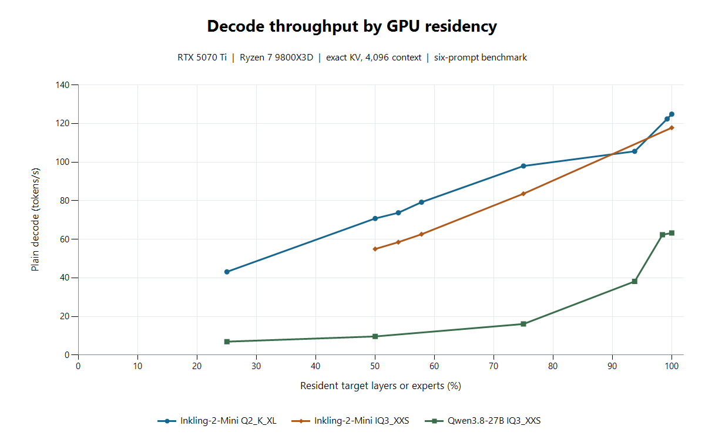

# Host-resident weights

The binder and the memory estimator use the same offload plan. The model owns the placement, transfer streams and staging slots through `OffloadRuntime`. A sequence owns its round graphs. The elastic fitter accounts separately for resident weights, device workspace, pinned host memory and pageable archives.

`--gpu-layers N` keeps the first N target attention or GDN layers and their MLPs resident. `--gpu-experts N` specifies an average over physical expert layers. Repeated program visits share one weight allocation. An explicit zero is valid for either limit. The elastic fitter searches both axes when one cannot cover the deficit. The public backend ABI carries the limits in version 53.

## Routed experts

**Mapped GPU execution.** On devices that support host-backed CUDA virtual memory, each expert plane has a stable GPU address. The loader places whole pages on the device or in pinned host memory. The resident byte budget includes scales and respects the driver allocation granularity. Small scale planes can stay entirely resident. Regular GPU projections read the same packed bytes and use the same accumulation order at every placement. A fully resident layer needs neither a logical-to-physical map nor a route handoff. The whole round can use a CUDA graph. A low pinned memory budget or unsupported mapping selects the CPU strategy.

**Placement.** Near full residency the initial plan concentrates the cold suffix into a few physical layers. It preserves the total expert count and charges the cost of each projection. Partially resident layers count logical routes on device during prefill and decode. At the end of a single active prompt or between sessions, the runtime halves previous scores and adds the new counts. It ranks experts across layers by demand per byte and groups each layer's most requested experts into adjacent physical slots. It can exchange the backing of equal-sized pages across layers using one device page of scratch. Concurrent sessions prevent exchanges. Live graphs keep stable addresses and each logical expert retains its original bytes. The reported decode hit rate counts a route only when every required page of that expert resides on the device.

**Prefill and verification.** A large prompt chunk uses separate gate/up and down staging slots when the planned placement predicts a host expert per row. Upload and consumption events protect each slot, allowing the copy stream to fill the next projection while the GPU computes. Small verify rounds can gather each distinct expert's packed bytes into sequence-owned scratch. Logical routes that select the same expert reuse the first copy. Once decode observations exist, the backend estimates the fraction of rows with a host selection from each physical layer's observed hit fraction and top-k. It halves previous observations when new ones arrive and gathers when a majority of the sampled rows are likely to benefit. A sequence sizes the scratch for the widths known at admission. Wider plans can always use the mapped weights directly. `expert_gather=0` disables this gather.

A gathered round on its sequence's own stream copies only the experts with host pages. Each layer keeps a device table of the physical slots whose pages are all on the device, refreshed after every page exchange. One small kernel assigns each selected host expert a copy slot in order of first occurrence. A second stream copies the gate/up planes while the device-resident experts' gate/up GEMM runs in place as one expert bank. The copied bank's gate/up GEMM waits for the copies; the down planes then take the same scratch, copied beside the resident down GEMM. One weighted sum in the router's order reads both banks' slots, so a token's result does not depend on the split. The scratch is the one the full gather used, so every pair can have a copy. `expert_overlap=0` restores the gather of every selected expert before each GEMM.

**CPU fallback.** With `expert_direct=0`, the resident GPU and the host row pool evaluate their selected experts concurrently. A small route packet publishes normalized activations and mapped slot IDs to pinned memory with a system-scope release. The host performs an acquire load, briefly polls and falls back to the CUDA event. The event also serves devices without mapped buffers. The host groups cold pairs by physical expert and shards projection rows among workers. SIMD kernels reuse decoded weight blocks across up to eight prepared activation rows at a time. A visit with no cold selections skips CPU computation and result upload. The mapped reduction reads resident or CPU results in router order. CPU arithmetic can differ from the GPU and requires a separate cross-placement accuracy check.

The CPU strategy can retain a second, GPU-packed archive for staged prompt processing and quiescent swaps. Both copies count against the host memory budget. `expert_prefill_min=0` disables the packed archive, `expert_adapt=0` fixes placement, and `expert_ticket=0` and `expert_mapped_output=0` select the event and explicit upload controls. Runtime CPU dispatch checks both instruction support and operating-system vector state. Use `expert_threads`, `expert_simd` and `expert_integer` for CPU comparisons.

The quant in a GGUF filename describes the bundle. The two local Inkling files use these tensor types for the 24 physical gate/up and down matrices. Each matrix contains 128 experts.

| Checkpoint | Gate/up matrices | Down matrices |
| --- | --- | --- |
| Inkling-2-Mini-UD-Q2_K_XL | 11 IQ2_S, 6 IQ1_S, 5 IQ2_XXS, 2 IQ2_XS | 12 Q2_0, 11 NVFP4, 1 MXFP4 |
| Inkling-2-Mini-UD-IQ3_XXS | 13 IQ3_XXS, 9 IQ2_S, 1 IQ2_XXS, 1 IQ2_XS | 20 NVFP4, 4 IQ4_NL |

The dense Qwen3.8-27B-UD-IQ3_XXS GGUF uses the Qwen3.5 architecture. Its 64 target layers mix gated delta net and attention blocks. The planner counts the target mixers separately from the MTP companion. The transfer unit uses the physical CUDA bytes of each projection after binding. For example, a stack of different packed types retains one typed run per group of adjacent matrices with the same type.

## Dense layer streaming

The loader preserves the CUDA projection layout, including packed codes, scales, column dimensions and row permutations. Streamed projections are assembled at load, archived in page-locked RAM and released from VRAM before the next block. Each attention or GDN mixer and its MLP form separate transfer units. Two VRAM slots are sized for the largest unit assigned to each slot. Norms, small vectors, embeddings, output head and recurrent state follow the regular backend placement policy. The copy stream waits on a slot's last compute event, copies the next weight image and records readiness. The compute stream waits for readiness and returns the slot after its last use. This permits copy of the next block while the current block computes. Every prefill row or verification row in a pass reuses that transfer.

A split round captures each contiguous resident span and each streamed transfer unit at its fixed slot address. Replay enqueues the first copy before the preceding resident graph and waits at the first consumer. CPU expert visits remain explicit steps between captured spans. Sessions with an incompatible cross-span K/V transfer use eager execution. Model-owned staging has a submission lock and stream dependencies across sessions. Full residency allocates neither workspace and uses the existing capture and batching paths. Pinned dense weights consume physical host memory throughout inference. When the pinned budget covers the two bounce slots but cannot hold all dense images, the loader archives them in pageable memory and copies through those slots. DV target attention and MLP projections stay resident because the DV context program also reads them.

## Architectural references

Basalt's Inkling-2 documentation describes profile-guided placement, dynamic changes as KV grows, and staging experts on GPU for prefill. Its distributed v0.5.7 profile ranks 24 physical layers of 128 experts. Its pool groups routed rows by expert and selects AVX2 or AVX-512 row kernels by format and CPU capability. The GPU checks a per-visit completion ticket. The local runtime log reported seven workers and 1,354 of 3,072 experts in RAM for that pack. [Basalt Inkling-2 placement](https://github.com/jesdga95/basalt/blob/v0.5.7/docs/models/inkling2.md) [CPU row kernels](https://github.com/jesdga95/basalt/blob/v0.5.7/src/kernels/cpu/native_expert.cpp)

Strata's Inkling hybrid dispatcher uses host-visible doorbells, CPU SIMD kernels and a persistent worker pool. It tracks decaying expert hit counts for promotion and can switch prefill to double-buffered DMA feeding GPU GEMMs. On Windows it can store weights in pageable RAM and copy through a small pinned buffer when pinning the arena would exceed its budget. Flyx retains a CUDA event as the bounded-poll fallback and uses stream-ordered events to protect shared staging storage. [Strata hybrid dispatcher](https://github.com/Niko1221/Strata/blob/c234774038d1c9249cb33637d27b895d47b39786/engine/src/inkling2/cuda/ink_hybrid.cuh) [CUDA host programming](https://docs.nvidia.com/cuda/cuda-programming-guide/03-advanced/advanced-host-programming.html)

## Measurements

`cuda_bench h2d` measures the pinned H2D ceiling with 4, 32 and 256 MiB transfers. Verbose streaming runs report DMA bandwidth during sampled copies, separately for prefill and rounds. Device timestamps exclude the wait for a free slot. For plain decode, multiply the logged streamed bytes per full pass by steady-state passes per second to obtain effective streaming bandwidth. For multirow prefill use the actual number of passes, including the final short pass. Compare on the same prompt, context, GPU, driver, clocks and build. Verbose hybrid runs report the wall time from enqueuing the route copies to observing their event per layer visit, including GPU work ahead of the copies.

### Split graphs and mapped experts on RTX 5070 Ti

Windows 11 build 26300, driver 610.88, RTX 5070 Ti (16,303 MiB), Ryzen 7 9800X3D (8C/16T), 32 GB DDR5-6000. The six prompts, exact K/V, 4,096-token context and reproduction command below match the v2 comparison. Prefill uses 1,024-token chunks. Decode pools prompts two through six, excluding the first generated token. Each timing process starts with idle GPU utilization. The complete placement, DSpark width, accuracy and CPU fallback tables are in [PR #70](https://github.com/enwove/flyx/pull/70).



| Inkling Q2_K_XL resident budget | Plain tok/s | 2,897-token prefill tok/s | Decode expert hit rate |
| --- | ---: | ---: | ---: |
| 128/128 | 124.91 | 2,250 | 100% |
| 127/128 | 122.42 | 2,238 | 99.68% |
| 120/128 | 105.64 | 2,179 | 96.61% |
| 96/128 | 98.03 | 1,884 | 94.28% |
| 74/128 | 79.25 | 1,865 | 87.99% |
| 69/128 | 73.78 | 1,850 | 86.25% |
| 64/128 | 70.81 | 1,872 | 83.84% |
| 32/128 | 43.14 | 1,873 | 54.09% |

Every listed placement matched 96/96 full-resident generated IDs and gave zero mean KL and 100% top-1 on the 64 teacher-forced positions. In the 120/128 ablation, selecting prompt staging by the model-wide average produced 1,271 tok/s on the long prompt. Selecting it by each physical layer's cold fraction produced 2,179 tok/s. For Qwen IQ3_XXS, streaming one of 64 layers measured 62.37 tok/s versus 63.26 fully resident. More extensive streaming increases elapsed time with the transferred byte count. Tokens/s is the reciprocal of that time.

On Q2_K_XL with DSpark Q8_0, using the prefill route scores alone to select verification gathers gave 57.58 tok/s at 69/128 and 54.05 at 64/128 with width 3. Using the recent decode observations gave 63.94 and 61.59 tok/s respectively. At 69/128, width 5 gave 51.79 tok/s and width 7 gave 43.50. Every width matched the 96 plain IDs at its placement. Basalt v0.5.7 reported 102.8 to 109.1 tok/s with its NVFP4-MX8 pack and spec 8 on this machine.

The CPU fallback microbenchmark rotates through roughly 256 MiB of compressed weights and reports compressed weight bytes divided by elapsed time. Replace `THREADS` with 1, 8, 12 or 16 and `ROWS` with 1, 4 or 8. The single-row run includes a raw 64-bit read using the same pool, projection-row sharding and expert-sized dispatches. A physical-core affinity mask provides a separate eight-core control. Use the mapped strategy and `--backend-opt expert_direct=0` on the same prompt file to compare end-to-end execution.

```sh
cuda_bench cold_dot 2304 2304 THREADS ROWS
cuda_bench cold_dot 1152 2304 THREADS ROWS
```

At 2,304 columns the raw control read 46.07 GB/s with 16 threads. The same pool gave 15.77 GB/s for Q2_K, 6.79 for Q3_K, 16.97 for IQ3_XXS, 13.10 for Q4_K and 16.23 for Q6_K. Eight unrestricted threads reached 23.53 GB/s for IQ3_XXS, compared with 19.65 using one logical processor per physical core. These controls show that the row pool can move considerably more bytes than the unpack-and-dot kernels consume. Logical work also increases with the number of activation rows served from each compressed weight read.

At Q2 64/128 with two 96-ID inputs, fixed chunks of 4, 8, 16 and 32 rows produced 41.70, 46.39, 52.25 and 51.10 prefill tok/s on CPU, and 14.11, 26.81, 52.22 and 96.46 with GPU staging. Six-prompt CPU fallback profiling measured a 92.42 microsecond route handoff with the ticket and mapped output. Recording its fallback event before resident GEMMs cut that interval to 75.66 microseconds but reduced profiled decode from 31.99 to 29.16 tok/s. The regular mapped-GPU implementation avoids the CPU handoff entirely.

### Inkling-2 on RTX 5070 Ti

The tables in this subsection document v1 and v2 of the CPU expert strategy.

Measured on native Windows 11 build 26300, GeForce RTX 5070 Ti 16,303 MiB, driver 610.88, Ryzen 7 9800X3D (8 cores, 16 logical processors) and 32 GB DDR5-6000. Both Release builds targeted `120-real`. The baseline was PR #70 rebased onto `ab4a4b2b`, with elapsed-time instrumentation. The intermediate optimized build `e7c724e` used a 16-row streaming threshold. The final SKU crossover measurement appears below. The [PR benchmark table](https://github.com/enwove/flyx/pull/70) uses the final default and includes the elastic 8 GiB runs. The six questions in `bench/prompts/moe_offload.jsonl` include p512 and the town-record prompt used in the Strata and Basalt comparisons. They tokenize to 511 and 2,897 tokens with this template. The competitor clients counted 2,899.

| Q2_K_XL residency | v1 prefill 511 / 2,897 | v2 prefill 511 / 2,897, chunk 128 | v2 prefill 511 / 2,897, chunk 1,024 | v1 / v2 decode | v2 cache hits |
| --- | ---: | ---: | ---: | ---: | ---: |
| 128/128 | 1,694.74 / 1,402.55 | 1,699.09 / 1,399.51 | 2,398.33 / 2,235.46 | 127.45 / 127.39 | 100% resident |
| 96/128 | 38.94 / 41.44 | 693.50 / 667.66 | 1,794.71 / 1,991.58 | 20.40 / 38.20 | 90.47% |
| 64/128 | 21.99 / 20.65 | 346.50 / 342.59 | 1,183.52 / 1,624.28 | 13.25 / 27.88 | 74.85% |
| 32/128 | 11.82 / 14.77 | 232.61 / 233.05 | 878.45 / 1,375.73 | 9.05 / 21.94 | 52.44% |

All throughput values are tokens/s. Decode pools elapsed time and tokens after the first generated token over prompts two through six. Hit rate includes load-time calibration and all six prompts. With 64 resident experts, hits were 73.89% on the first user prompt, 84.85% on p512 and 74.51% on the town-record prompt. Pooling scores across physical layers yielded 57.99% overall, versus 74.85% for per-layer scoring. With 96 experts the corresponding rates were 80.29% and 90.47%.

| Q2_K_XL decode stage, chunk 128 | 64/128 tok/s | 96/128 tok/s |
| --- | ---: | ---: |
| GPU-streamed prompt, original CPU decode | 12.40 | 19.17 |
| Early submission and persistent pool, float AVX2, static placement | 12.16 | 19.55 |
| Integer SIMD and AVX-512 down, static placement | 20.49 | 28.44 |
| Cross-layer scores | 22.15 | 30.79 |
| Per-layer scores | 27.88 | 38.20 |

| Per-layer decode diagnostic, mean µs/visit | Route to host | CPU work | Resident GPU | Cold result H2D | Reduction |
| --- | ---: | ---: | ---: | ---: | ---: |
| v1 64/128 | 89.64 | 1,435.26 | 103.78 | 55.41 | 31.59 |
| v2 64/128 | 102.42 | 390.07 | 83.89 | 44.46 | 26.91 |
| v1 96/128 | 98.09 | 611.94 | 93.77 | 43.00 | 26.11 |
| v2 96/128 | 103.70 | 196.42 | 85.54 | 29.02 | 19.92 |

The per-layer run uses the first prompt, 12 generated tokens and `--backend-opt profile=1`. Event timing and a synchronization following the reduction change queue depth. In the regular six-prompt run the wall time from copy submission through observing readiness was 176.89 µs at 64/128 and 187.52 µs at 96/128. Cold CPU work read 16.06 and 13.86 GB/s of compressed rows respectively, including activation preparation and pool handoffs in elapsed time. A secondary-stream CUDA host callback took 382.21 µs to hand work to the CPU in a 64/128 probe and reduced five-prompt decode throughput from 26.9 to 24.6 tok/s. The event path remains in use.

Reproduce a throughput run by substituting the checkpoint path and resident count. Repeat with both chunk sizes. For the ablations use `expert_adapt=0`, `expert_adapt=0,expert_integer=0,expert_simd=256` or `expert_global=1` as a single backend option. For the DSpark comparison replace `--no-spec --width 0` with `--drafter dspark --drafter-file DRAFTER --width 3` or width 7.

```sh
flyx bench MODEL --backend cuda --kv-method exact --no-lookup --ctx 4096 --prefill-chunk 1024 -v --prompts bench/prompts/moe_offload.jsonl -n 16 --ignore-eos --json result.json --no-spec --width 0 --gpu-experts N
kld MODEL --text bench/prompts/p512.txt --tokens 64 --start 16 --ctx 1024 --kv-method exact --prefill-chunk 128 --save resident.bin
kld MODEL --text bench/prompts/p512.txt --tokens 64 --start 16 --ctx 1024 --kv-method exact --prefill-chunk 128 --ref resident.bin --backend-options gpu_experts=N
```

A separate crossover test used three 97-token prompts and two generated tokens with static residency. The CPU and staged paths were forced with `expert_prefill_min=0` and `expert_prefill_min=2`. At 96/128, CPU / staged prefill was 82.3 / 43.3 tok/s at eight rows, 91.2 / 86.8 at 16, 89.6 / 168.2 at 32 and 88.9 / 219.9 at 64. At 64/128 the staged path also led at 32 rows (79.8 versus 38.9) and 64 rows (106.3 versus 44.8). The 5070 Ti table therefore selects 32 rows. Other devices use a portable starting point of one routed slot per expert on average. The table setting applies to prompt passes only.

A host-visible CUDA stream-write ticket also ran slower than the event path. At 64/128 its five-prompt decode and handoff were 26.85 tok/s and 211.55 microseconds, versus 28.21 tok/s and 176.44 microseconds with events. At 96/128 the corresponding figures were 36.19 / 221.75 and 38.99 / 185.50. A VNNI gate/up variant sharing each vector load gave 26.83 versus 26.72 tok/s at 64/128 and 38.20 versus 39.31 at 96/128. The retained CPU path shares activation preparation and scheduling and keeps independent row products. At 64/128, four, seven, eight, twelve and sixteen total CPU threads yielded 15.28, 21.03, 21.99, 27.51 and 27.97 tok/s.
