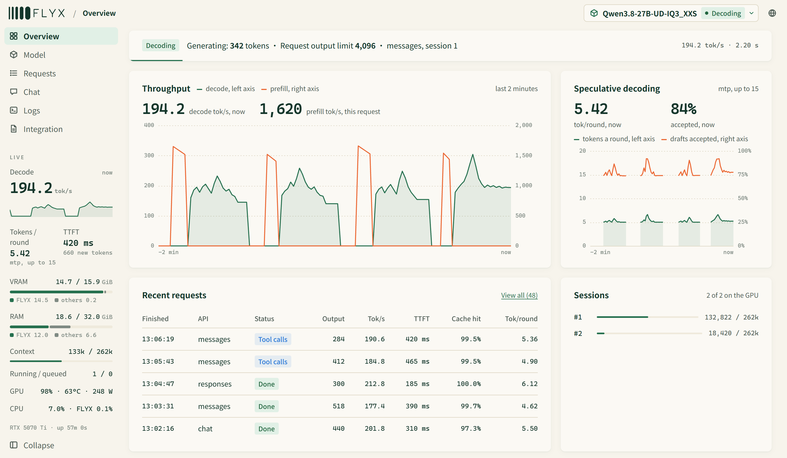

<p align="center">
  <picture>
    <source media="(prefers-color-scheme: dark)" srcset="../brand/flyx-readme-banner-dark.svg">
    
  </picture>
</p>

<p align="center">
  <a href="../../LICENSE"></a>
  
  <a href="https://discord.gg/ZtUPXBxYhN"></a>
  <a href="https://enwove.ai/flyx/wechatqr"></a>
</p>

<p align="center">
  <a href="../../README.md">English</a> ·
  <a href="README_zh.md">中文</a> ·
  <a href="README_ja.md">日本語</a> ·
  <a href="README_ko.md">한국어</a> ·
  <a href="README_es.md">Español</a> ·
  <a href="README_fr.md">Français</a> ·
  <b>Deutsch</b>
</p>

---

<p align="center">
  <a href="#schnellstart">Schnellstart</a> ·
  <a href="#leistung">Leistung</a> ·
  <a href="../models.md">Modelle</a> ·
  <a href="../server.md">CLI &amp; API</a> ·
  <a href="../../llms.txt">llms.txt</a>
</p>

**FLYX** ist eine lokale LLM-Engine ohne Abhängigkeiten. Unterstützte GGUF-Modelle laufen direkt und sind über OpenAI- und Anthropic-kompatible APIs für Browser, Skripte und Coding-Agenten erreichbar.

<p align="center">
  
  <br><sub>Integriertes Web-Dashboard: Modellverwaltung, Chat, Live-Durchsatz, Speicheraufteilung und Agenten-Einrichtung per Klick.</sub>
</p>

## Kernfunktionen

- Für lange Kontexte nutzt FLYX VRAM und Arbeitsspeicher. Reicht eine Erhöhung eines der beiden Budgets aus, zeigt FLYX die zusätzlich benötigten Bytes an.
- **Pro GPU abgestimmt, keine manuellen Flags** — Liefert gemessene Kernel-Tuning-Tabellen für 11 NVIDIA-GPUs mit und bestimmt Kontextlänge, K/V-Präzision und GPU/RAM-Aufteilung automatisch anhand des verfügbaren Speichers. Kein Rätselraten bei Offload-Schichten, Batch-Größen oder Cache-Typen.
- **Keine Installation, keine Abhängigkeiten, ~57 MB** — Die Windows-Datei enthält die CUDA- und C++-Laufzeiten.
- **Integriertes Web-Dashboard & Terminal-Monitor** — Startet direkt in einer Browser-Oberfläche (7 Sprachen) mit geführten Hinweisen zum Suchen/Herunterladen von Hugging-Face- oder lokalen Modellen, Chatten, lokalisierten API-Dokumenten sowie Live-Überwachung von Durchsatz, VRAM/RAM-Aufteilung, Sitzungen, Anfragen und Protokollen ([Monitor-Leitfaden](../monitor.md)).
- **Ein-Klick-Integration für Coding-Agenten** — Spricht OpenAI (Chat Completions, Responses) und Anthropic Messages inklusive Tool-Calls und Multi-Turn-Präfix-Wiederverwendung. Starten Sie **Claude Code** oder **Codex CLI** unter **Integration** direkt in Ihrem Projektordner (Windows) oder kopieren Sie sofort ausführbare Befehle für **DeepSeek Harness, OpenCode und Pi**.
- Kerneltests vergleichen CUDA-Ergebnisse mit Float64-Referenzen. Die Benchmarks nennen Geräte und Prompts, für die spekulative und normale Dekodierung dieselben Token-IDs lieferten. [float64](../design/numerics.md).

## Neuigkeiten

- **v0.2.1** — Inkling-2-Mini nutzt ein sparsames MoE, optimierte Dekodierkernel und den automatisch geladenen Markov-Drafter DSpark. Qwen3.5/3.8 verarbeitet Bilder mit passendem Projektor. Der Hub findet Begleitdateien. Mit **Draft with it** lässt sich ein Drafter auswählen. FLYX passt ihn an den freien VRAM an. DFlash2 nutzt bei gleitendem Fenster einen KV-Ringpuffer. Der Windows-Kandidat ohne PTX ist mit 57,15 MB kleiner als v0.2.0 (58,96 MB).
- **`v0.2.0`** — **Erste Open-Source-Veröffentlichung von FLYX**: eigenständige ~59 MB Windows-`.exe` und Linux-Tarball ohne Abhängigkeiten, native Vollkontext-GGUF- & NVFP4-Inferenz mit automatischer GPU/RAM-K/V-Erweiterung, integriertes spekulatives Dekodieren (MTP / DFlash2), 7-sprachiges Web-Dashboard und Ein-Klick-Integration für Claude Code / Codex CLI.

## Leistung

Qwen3.8-27B in Token/s. Die ersten drei Werte gelten für drei gemischte Prompts mit je 128 Ausgabetokens. Die letzte Spalte nutzt den ersten Code-Prompt mit 128 Tokens ohne Prompt-Lookup.

| GPU | Qwen3.8-27B | Ohne Drafter | MTP | DFlash2 | DFlash2 bei Code |
|---|---|---:|---:|---:|---:|
| RTX 5090 · Linux | NVFP4 | 93.8 | 286.6 | 315.5 | 565.5 |
| RTX 4090 · Linux | UD-Q4_K_XL | 49.4 | 158.0 | 171.6 | 305.7 |
| RTX 3090 · Linux | UD-Q4_K_XL | 42.8 | 121.7 | 131.2 | 234.1 |
| RTX 5070 Ti · Windows | UD-IQ3_XXS | 68.8 | 167.2 | 154.4 | 332.8 |

Inkling-2-Mini (UD-IQ3_XXS), ohne Drafter → Markov DSpark (Q8_0), in Token/s. Jedes Paar lieferte identische Token-IDs.

| GPU | chat_short · 8 × 128 | code_short · 8 × 384 |
|---|---:|---:|
| RTX 5090 · Linux | 225.5 → 259.8 | 228.5 → 438.9 |
| RTX 4090 · Linux | 166.7 → 202.9 | 167.9 → 322.4 |
| RTX 3090 · Linux | 126.2 → 136.5 | 126.9 → 222.0 |
| RTX 5070 Ti · Windows | 150.9 → 169.3 | 153.6 → 276.2 |

[Messwerte und Befehle](../benchmarks.md#v021-four-gpu-verified-benchmarks)

## Schnellstart

### 1. Herunterladen und starten (empfohlen)

Laden Sie das aktuelle Release von [GitHub Releases](https://github.com/enwove/flyx/releases) herunter — es wird lediglich ein NVIDIA-Treiber (≥ 580) benötigt:

- **Windows:** Doppelklicken Sie auf `flyx-0.2.1-windows-x86_64-cuda13.exe` (oder führen Sie `.\flyx-0.2.1-windows-x86_64-cuda13.exe serve` in PowerShell aus). Der Server startet und öffnet das Dashboard automatisch (und wählt einen anderen freien Port, falls `8080` belegt ist).
- **Linux / WSL2:** Archiv entpacken und starten:

```sh
./bin/flyx serve
# Oder ein Hugging-Face-GGUF direkt in den Standard-HF-Cache laden:
./bin/flyx serve unsloth/Qwen3.8-27B-GGUF:UD-Q4_K_XL
```

Hub-Downloads unter Linux nutzen die libcurl-Bibliothek des Systems.

Der erste Befehl lädt DSpark automatisch. Der zweite verarbeitet ein Bild mit Qwen und dem passenden Projektor aus dem Hub.

```sh
flyx serve unsloth/Inkling-2-Mini-GGUF:UD-IQ3_XXS
flyx run unsloth/Qwen3.8-27B-GGUF:UD-Q4_K_XL --image photo.png --chat -p "Describe the image."
```

Öffnen Sie das Dashboard unter `http://127.0.0.1:8080` → wählen oder laden Sie ein Modell unter **Modell** → starten Sie **Claude Code / Codex** direkt (oder kopieren Sie beliebige Agenten-Befehle) unter **Integration**.

| Client / Endpunkt | Basis-URL |
|---|---|
| OpenAI-SDKs (Chat Completions, Responses, Completions) | `http://127.0.0.1:8080/v1` |
| Anthropic-SDKs & Claude Code (`ANTHROPIC_BASE_URL`) | `http://127.0.0.1:8080` |
| Web-Dashboard | `http://127.0.0.1:8080/` |
| Telemetrie-JSON (`flyx monitor`) | `http://127.0.0.1:8080/v1/telemetry` |

<details>
<summary><b>Aus dem Quellcode bauen</b> (CUDA 13, CMake 3.24+, Ninja, g++ 11+ / MSVC 2022)</summary>

```sh
cmake --preset dev && cmake --build --preset dev    # Ausgaben in ~/flyx-build/bin

# Direkt per Hugging-Face-Name ausführen oder bereitstellen
~/flyx-build/bin/flyx run unsloth/Qwen3.8-27B-GGUF:UD-Q4_K_XL --chat -p "Schreibe ein Haiku über GPUs."
~/flyx-build/bin/flyx serve unsloth/Qwen3.8-27B-GGUF:UD-Q4_K_XL --port 8080
```

> **WSL2-Hinweis:** Belassen Sie Build-Verzeichnisse und Modelldateien im Linux-Dateisystem (`~/models`, `~/flyx-build`); `/mnt/<drive>` verlangsamt das Laden von Modellen erheblich.

</details>

<details>
<summary><b>Python-Nutzung &amp; curl-Beispiel</b></summary>

```sh
curl http://127.0.0.1:8080/v1/chat/completions -H "Content-Type: application/json" \
  -d '{"messages": [{"role": "user", "content": "Hallo!"}]}'
```

```python
import flyx

eng = flyx.Engine("~/models/Qwen3.8-27B-UD-Q4_K_XL.gguf", lib="~/flyx-build/bin/libflyx.so")
reply = eng.session().chat_full(
    [{"role": "user", "content": "Wie heißt die Hauptstadt von Frankreich?"}],
    enable_thinking=False,
    max_new_tokens=64,
)
print(reply["content"])
```

</details>

## Unterstützte Modelle & Hardware

| Bereich | Unterstützt | Hinweise |
|---|---|---|
| Architekturen | GGUF: Qwen3 (`qwen3`), Qwen3.5/3.8 (`qwen35`), Inkling-2-Mini (`inkling2_loop`) | Qwen3.5/3.8 + `qwen3vl_merger` · Inkling-2-Mini + Markov DSpark · DFlash2 / DSpark: `dflash` · Llama: `.flyx` |
| Modellformate | GGUF (`F32`, `F16`, `BF16`, `Q4_0–Q8_0`, `Q2_K–Q6_K`, `IQ1–IQ4`, `MXFP4`, `Q2_0`, GGML NVFP4); `.flyx` (BF16, NVFP4; Format 2 mit eigenen LoRA-Adaptern des Zielmodells, V-LoRA, ungemergt ausgeführt; DV-Drafter nur bei expliziter Angabe `--drafter dv`, [Design](../design/dv.md)) | Alle Teile eines geteilten GGUF müssen im selben Ordner liegen. |
| GPUs | RTX-30-/40-/50-Serie, L4, L40S, A100, H100 (`sm_80`–`sm_120`; `sm_100` im Linux-Release) | Eine GPU pro Prozess (`CUDA_VISIBLE_DEVICES`); Treiber ≥ 580 |
| Plattformen | Windows (natives MSVC), Linux, WSL2 | Einzelne `.exe` / ZIP / Wheel unter Windows; Tarball / `manylinux`-Wheel unter Linux |

## Dokumentation

Für KI-Agenten empfiehlt sich der Einstieg über [llms.txt](../../llms.txt).

- **Nutzung & Integration:** [docs/server.md](../server.md) · [docs/models.md](../models.md) · [docs/monitor.md](../monitor.md) · [docs/benchmarks.md](../benchmarks.md)
- **Build & Tests:** [docs/building.md](../building.md) · [docs/testing.md](../testing.md)
- **Design & Verträge:** [docs/design/architecture.md](../design/architecture.md) · [docs/design/numerics.md](../design/numerics.md) · [docs/design/gguf.md](../design/gguf.md) · [docs/design/tree-verification.md](../design/tree-verification.md) · [docs/design/dv.md](../design/dv.md)
- **Mitwirken & Governance:** [AGENTS.md](../../AGENTS.md) · [CONTRIBUTING.md](../../CONTRIBUTING.md) · [SECURITY.md](../../SECURITY.md) · [docs/prior-art.md](../prior-art.md)

## Kontakt

- **Discord:** [Dem FLYX-Discord beitreten](https://discord.gg/ZtUPXBxYhN)
- **WeChat:** [QR-Code der WeChat-Gruppe scannen](https://enwove.ai/flyx/wechatqr)
- **Fehler & Feedback:** [GitHub Issues](https://github.com/enwove/flyx/issues)

Für Kooperationen und Partnerschaften erreichen Sie uns unter [contact@enwove.ai](mailto:contact@enwove.ai).

## Lizenz

Apache-2.0. Hinweise zu Drittanbietern finden sich in [NOTICE](../../NOTICE) und [docs/prior-art.md](../prior-art.md).
