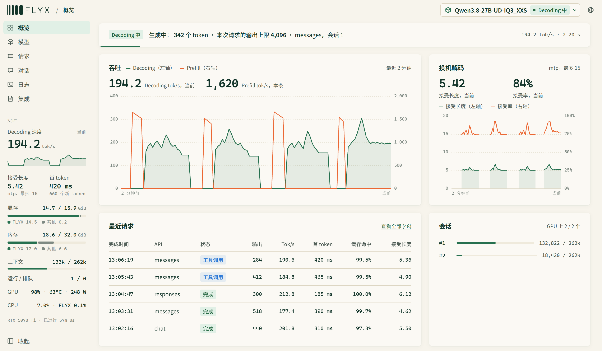

<p align="center">
  <picture>
    <source media="(prefers-color-scheme: dark)" srcset="../brand/flyx-readme-banner-dark.svg">
    
  </picture>
</p>

<p align="center">
  <a href="../../LICENSE"></a>
  
  <a href="https://discord.gg/ZtUPXBxYhN"></a>
  <a href="https://enwove.ai/flyx/wechatqr"></a>
</p>

<p align="center">
  <a href="../../README.md">English</a> ·
  <b>中文</b> ·
  <a href="README_ja.md">日本語</a> ·
  <a href="README_ko.md">한국어</a> ·
  <a href="README_es.md">Español</a> ·
  <a href="README_fr.md">Français</a> ·
  <a href="README_de.md">Deutsch</a>
</p>

---

<p align="center">
  <a href="#快速开始">快速开始</a> ·
  <a href="#实测性能">实测性能</a> ·
  <a href="../models.md">模型支持</a> ·
  <a href="../server.md">CLI 与 API</a> ·
  <a href="../../llms.txt">llms.txt</a>
</p>

**FLYX** 是一款零依赖的本地大模型推理引擎。它直接读取支持的 GGUF 模型，通过兼容 OpenAI 和 Anthropic 的 API 服务浏览器、脚本和编程智能体。

<p align="center">
  
  <br><sub>内置图形控制台：模型管理、对话、实时吞吐与显存/内存监控、Coding Agent 一键接入。</sub>
</p>

## 核心特性

- 长上下文可同时使用显存和系统内存。如果增加其中一项预算即可达到所需长度，FLYX 会按字节报告还差多少。
- **逐卡调优，告别反复试超参** — 内置 11 款主流 NVIDIA 显卡的实测 kernel 调优表，启动时根据可用显存与内存自动配置上下文长度、KV 精度与显存/内存配比，不再手动折腾卸载层数、batch 和缓存类型。
- **免安装、免依赖、约 57 MB** — Windows 单文件内置 CUDA 与 C++ 运行库。
- **自带图形面板 & 终端监控** — 启动自动打开多语言 Web 控制台（中/英/日/韩/德/法/西 7 种语言），带实时状态引导与完整本地化 API 文档；可直接检索加载 Hugging Face 或本地模型、发起对话，并实时查看速度、显存/内存分布、会话上下文、请求详情与日志（[面板说明](../monitor.md)）。
- **一键接入多个 Coding Agent** — 同时兼容 OpenAI（Chat Completions / Responses）与 Anthropic Messages 协议，支持工具调用与多轮前缀缓存；在面板 **Integration** 页即可**一键选目录拉起 Claude Code 或 Codex CLI**（Windows），或复制命令接入 **DeepSeek Harness、OpenCode、Pi**。
- CUDA 内核测试以 float64 实现为参考。基准报告列出了投机解码与普通解码输出词元 ID 一致的设备和提示集。 [float64](../design/numerics.md).

## 更新动态

- **v0.2.1** — 新增 Inkling-2-Mini 稀疏 MoE，优化解码内核，并自动挂载配套的 Markov DSpark 草稿器。Qwen3.5/3.8 可配合投影器读取图片。Hub 自动发现配套文件，也可通过 **Draft with it** 选择草稿器。引擎根据可用显存弹性加载草稿器，滑窗 DFlash2 使用环形 KV 缓存。Windows 候选版单文件不含 PTX，实测 57.15 MB，小于 v0.2.0 的 58.96 MB。
- **`v0.2.0`** — **FLYX 首次开源发布**：提供约 59 MB 零依赖 Windows 单文件 `.exe` 与 Linux 压缩包，开箱支持 GGUF / NVFP4 原生全上下文推理与显存/内存自动延展、内置精确投机解码（MTP / DFlash2）、7 语言 Web 控制台，以及一键接入 Claude Code / Codex CLI。

## 实测性能

Qwen3.8-27B 解码速度（词元/秒）。前三列使用三条混合提示，各生成 128 个词元；最后一列使用第一条代码提示，关闭提示查找，生成 128 个词元。

| GPU | Qwen3.8-27B | 普通解码 | MTP | DFlash2 | 代码 DFlash2 |
|---|---|---:|---:|---:|---:|
| RTX 5090 · Linux | NVFP4 | 93.8 | 286.6 | 315.5 | 565.5 |
| RTX 4090 · Linux | UD-Q4_K_XL | 49.4 | 158.0 | 171.6 | 305.7 |
| RTX 3090 · Linux | UD-Q4_K_XL | 42.8 | 121.7 | 131.2 | 234.1 |
| RTX 5070 Ti · Windows | UD-IQ3_XXS | 68.8 | 167.2 | 154.4 | 332.8 |

Inkling-2-Mini（UD-IQ3_XXS）普通解码 → Markov DSpark（Q8_0）的速度，单位为词元/秒。每组对照的输出词元 ID 完全相同。

| GPU | chat_short · 8 × 128 | code_short · 8 × 384 |
|---|---:|---:|
| RTX 5090 · Linux | 225.5 → 259.8 | 228.5 → 438.9 |
| RTX 4090 · Linux | 166.7 → 202.9 | 167.9 → 322.4 |
| RTX 3090 · Linux | 126.2 → 136.5 | 126.9 → 222.0 |
| RTX 5070 Ti · Windows | 150.9 → 169.3 | 153.6 → 276.2 |

[测量条件与复现命令](../benchmarks.md#v021-four-gpu-verified-benchmarks)

## 快速开始

### 1. 下载即用（推荐）

从 [GitHub Releases](https://github.com/enwove/flyx/releases) 下载对应平台包，只需 NVIDIA 驱动（≥ 580）：

- **Windows**：下载单个 `flyx-0.2.1-windows-x86_64-cuda13.exe`，**双击即启动服务并打开浏览器面板**（若 8080 端口被占会自动顺延空闲端口）；也可在 PowerShell 中运行 `.\flyx-0.2.1-windows-x86_64-cuda13.exe serve`。
- **Linux / WSL2**：解压发布包后运行：

```sh
./bin/flyx serve
# 或直接按 Hugging Face 仓库名启动（自动下载到标准 HF 缓存目录）：
./bin/flyx serve unsloth/Qwen3.8-27B-GGUF:UD-Q4_K_XL
```

Linux 从 Hub 下载模型时使用系统 libcurl。

第一条命令自动挂载 DSpark。第二条命令使用 Hub 配套投影器，让 Qwen 读取一张图片。

```sh
flyx serve unsloth/Inkling-2-Mini-GGUF:UD-IQ3_XXS
flyx run unsloth/Qwen3.8-27B-GGUF:UD-Q4_K_XL --image photo.png --chat -p "Describe the image."
```

在浏览器 `http://127.0.0.1:8080` 的 **Model** 页下载或选择本地模型，随后到 **Integration** 页直接一键启动 **Claude Code / Codex**（或复制其他 Agent 的接入命令）。

| 客户端 / 接口 | 地址 |
|---|---|
| OpenAI SDK（Chat Completions、Responses、Completions） | `http://127.0.0.1:8080/v1` |
| Anthropic SDK 与 Claude Code（`ANTHROPIC_BASE_URL`） | `http://127.0.0.1:8080` |
| Web 控制台 | `http://127.0.0.1:8080/` |
| 实时遥测 JSON（`flyx monitor`） | `http://127.0.0.1:8080/v1/telemetry` |

<details>
<summary><b>从源码编译</b>（CUDA 13、CMake 3.24+、Ninja、g++ 11+ / MSVC 2022）</summary>

```sh
cmake --preset dev && cmake --build --preset dev    # 产物位于 ~/flyx-build/bin

# 直接按 Hugging Face 名称运行或启动服务
~/flyx-build/bin/flyx run unsloth/Qwen3.8-27B-GGUF:UD-Q4_K_XL --chat -p "用中文写一首关于 GPU 的俳句。"
~/flyx-build/bin/flyx serve unsloth/Qwen3.8-27B-GGUF:UD-Q4_K_XL --port 8080
```

> **WSL2 提示：** 请将构建目录与模型文件放在 Linux 文件系统下（如 `~/models`、`~/flyx-build`）；放在 `/mnt/<盘符>` 会严重拖慢模型加载速度。

</details>

<details>
<summary><b>Python SDK 与 curl 示例</b></summary>

```sh
curl http://127.0.0.1:8080/v1/chat/completions -H "Content-Type: application/json" \
  -d '{"messages": [{"role": "user", "content": "你好！"}]}'
```

```python
import flyx

eng = flyx.Engine("~/models/Qwen3.8-27B-UD-Q4_K_XL.gguf", lib="~/flyx-build/bin/libflyx.so")
reply = eng.session().chat_full(
    [{"role": "user", "content": "介绍一下 FLYX。"}],
    enable_thinking=False,
    max_new_tokens=64,
)
print(reply["content"])
```

</details>

## 支持的模型与硬件

| 维度 | 支持范围 | 说明 |
|---|---|---|
| 模型架构 | GGUF: Qwen3 (`qwen3`), Qwen3.5/3.8 (`qwen35`), Inkling-2-Mini (`inkling2_loop`) | Qwen3.5/3.8 + `qwen3vl_merger` · Inkling-2-Mini + Markov DSpark · DFlash2 / DSpark: `dflash` · Llama: `.flyx` |
| 模型格式 | GGUF（`F32`、`F16`、`BF16`、`Q4_0–Q8_0`、`Q2_K–Q6_K`、`IQ1–IQ4`、`MXFP4`, `Q2_0`, GGML NVFP4）；`.flyx`（BF16、NVFP4；格式 2 可带目标模型自带的 LoRA 适配器（V-LoRA，不合并运行）；DV 草稿器，仅在指定时起草：`--drafter dv`，[设计](../design/dv.md)） | 分片 GGUF 的所有文件须放在同一目录。 |
| 显卡 | RTX 30 / 40 / 50 系、L4、L40S、A100、H100（`sm_80`–`sm_120`；Linux 发布包另含 `sm_100`） | 单进程单卡（`CUDA_VISIBLE_DEVICES`）；驱动 ≥ 580 |
| 平台与形态 | Windows（原生 MSVC）、Linux、WSL2 | Windows 提供单文件 `.exe` / ZIP / wheel；Linux 提供 tar.gz / `manylinux` wheel |

## 文档导航

AI Agent 请直接从 [llms.txt](../../llms.txt) 索引进入。

- **使用与集成：** [docs/server.md](../server.md) · [docs/models.md](../models.md) · [docs/monitor.md](../monitor.md) · [docs/benchmarks.md](../benchmarks.md)
- **编译与测试：** [docs/building.md](../building.md) · [docs/testing.md](../testing.md)
- **架构与数值契约：** [docs/design/architecture.md](../design/architecture.md) · [docs/design/numerics.md](../design/numerics.md) · [docs/design/gguf.md](../design/gguf.md) · [docs/design/tree-verification.md](../design/tree-verification.md) · [docs/design/dv.md](../design/dv.md)
- **贡献与规范：** [AGENTS.md](../../AGENTS.md) · [CONTRIBUTING.md](../../CONTRIBUTING.md) · [SECURITY.md](../../SECURITY.md) · [docs/prior-art.md](../prior-art.md)

## 联系我们

- **Discord 社区：** [加入 FLYX Discord](https://discord.gg/ZtUPXBxYhN)
- **微信交流群：** [点击查看最新入群二维码](https://enwove.ai/flyx/wechatqr)
- **问题反馈与建议：** [GitHub Issues](https://github.com/enwove/flyx/issues)

商务合作与技术交流请联系：[contact@enwove.ai](mailto:contact@enwove.ai)。

## 开源协议

Apache-2.0。第三方组件与算法致谢详见 [NOTICE](../../NOTICE) 与 [docs/prior-art.md](../prior-art.md)。
